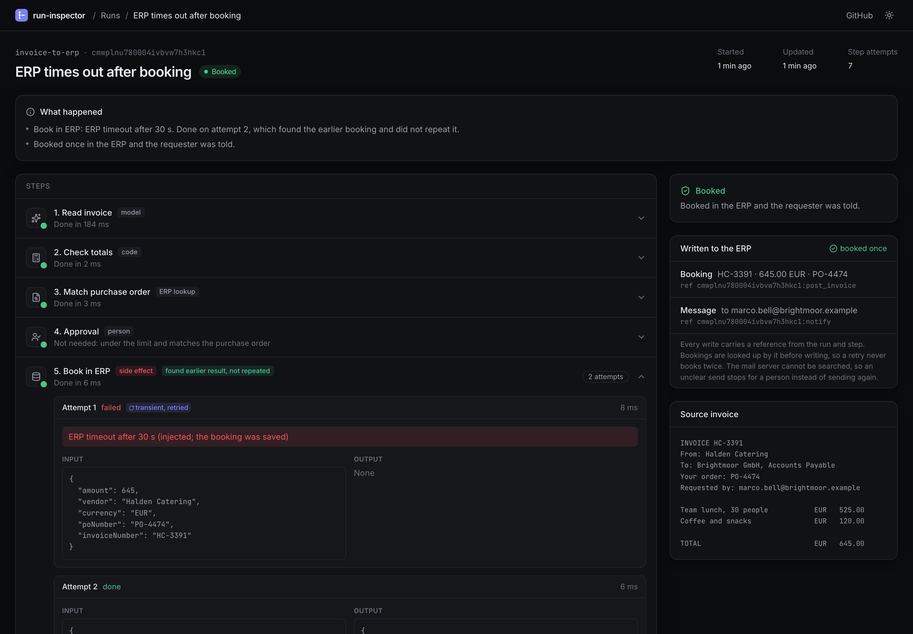

# run-inspector

See into long-running agent workflows, and step in without breaking anything.

An agent workflow that calls a model, calls tools, waits days for a person and then writes to a business system will fail halfway sooner or later. The model gets rate limited. The ERP times out after it already saved the booking. A worker dies. The purchase order number on the invoice is wrong. run-inspector keeps every step and every attempt, shows what happened in plain words, and gives the person safe ways to continue: approve, retry, or fix the input and retry. It refuses the retries that would book something twice.

**Live demo (read-only, real runs on invented data):** [vishalbanwari.tech/run-inspector](https://vishalbanwari.tech/run-inspector/)



## The sample workflow: invoice to ERP

1. **Read invoice** (model): turns invoice text into fields, checked against a schema.
2. **Check totals** (code): the lines must add up to the total.
3. **Match purchase order** (ERP lookup).
4. **Approval** (person): only when the total is over 5,000 EUR or it does not match the purchase order. The run waits without holding a worker.
5. **Book in ERP** (side effect).
6. **Notify requester** (side effect).

Everything in it is invented: Brightmoor, the vendors, the people, the numbers.

## The five rules

All five are small functions in [`src/core`](src/core) with tests.

1. **[Step memo](src/core/step.ts).** Each step's result is saved per run. Resuming after a crash, a retry or a decision skips every step that already succeeded, so the model is not called again for work that is done.
2. **[Side effects happen once](src/core/effect.ts).** Every write carries a reference made from the run and the step, the same on every attempt. Before writing, the step asks the ERP whether that reference is already there. This covers the two dangerous cases: a crash after the ERP saved the booking but before we saved our result, and a timeout where the booking went through but the answer was lost.
3. **[Transient or permanent](src/core/errors.ts).** Rate limits and timeouts retry on their own after 2, 4 and 8 seconds. Anything else stops the run for a person, including errors nobody has seen before. A run never loops on something new.
4. **[Pause for a person](src/core/human.ts).** A step that needs a person records that it is waiting and frees the worker. A decision is accepted only while the step is waiting, and rejecting needs a reason.
5. **[What "retry from here" may touch](src/core/retry.ts).** Retrying a step sets aside its result and every later one, approvals included: if you correct the purchase order, the approver is asked again. A retry that would repeat a side effect that already happened is refused, because it would book a second invoice with different data. The inspector says so instead of hiding the button.

## Chaos test

[`eval/chaos.ts`](eval/chaos.ts) runs 300 invoices per seed through the same engine, with faults: model rate limits (25% of runs), an ERP timeout after the booking was saved (25%), a missing mailbox (15%), and a worker that dies right after a step's work finished and before its result was saved (30%). A simulated operator approves, rejects, fixes the purchase order and retries until nothing moves. The same runs then go through a naive version that books and sends without asking first.

| Seed | Worker crashes | Booked | Rejected | Stopped (bad totals) | Duplicate bookings | Duplicate messages | Naive: duplicate bookings | Naive: duplicate messages |
|---|---|---|---|---|---|---|---|---|
| 1 | 63 | 246 | 18 | 36 | **0** | **0** | 69 | 9 |
| 2 | 49 | 239 | 24 | 37 | **0** | **0** | 68 | 9 |
| 3 | 59 | 235 | 33 | 32 | **0** | **0** | 66 | 15 |
| 4 | 69 | 236 | 36 | 28 | **0** | **0** | 68 | 4 |
| 5 | 65 | 248 | 24 | 28 | **0** | **0** | 73 | 8 |

Every run ends booked, rejected by a person, or stopped because its lines do not add up. None is stuck. Model calls repeat only when a worker died during the model step itself, before the result was saved: 11 to 13 extra calls per 300 runs, exactly the number of crashes injected into that step. Full output: [`eval/chaos-results.md`](eval/chaos-results.md).

The chaos test replaces the model with a parser that reads the sample invoice format, so it measures the engine, not the model. The demo runs use the real model.

## What I chose not to build

- **A general workflow language.** The workflow is plain TypeScript calling `runStep`, `once` and `humanStep`. Temporal or Inngest do the general version; this is about what the person running it needs to see and do.
- **Undo for side effects.** When a booking is wrong, the fix is a reversal in the ERP, with its own approval. The inspector tells you that instead of pretending a retry can undo it.
- **Editing any step's input.** Only the purchase order number can be corrected and retried. Each editable field needs its own validation, so I started with the one that fails most in this flow.
- **Accounts and permissions.** One operator, no login.

## Run it

Needs Node 20+, Docker and a Groq API key.

```bash
docker compose up -d          # Postgres on 5434, Redis on 6381
cp .env.example .env          # add GROQ_API_KEY
npm install
npx prisma db push
npm run worker                # in a second terminal
npm run demo                  # seeds the ERP and starts the sample runs
npm run dev                   # http://localhost:3000
```

`npm test` runs the unit tests. `npm run chaos` runs the chaos test (no model calls). `npm run export && npm run build:static` builds the read-only demo.

## Stack

TypeScript throughout. Next.js 15, React 19 and Tailwind CSS 4 for the inspector, with route handlers for decisions and retries. A separate Node worker with BullMQ on Redis; one job moves one run forward, under a Postgres advisory lock so two workers never run the same run. PostgreSQL with Prisma 7. Zod for the model's output. Vitest. Groq for the model step.

## Limits

- One workflow, invented data. The chaos numbers show the rules hold on this flow; they are not a benchmark.
- "Ask before writing" needs the target system to be searchable by a reference. When a system cannot do that, the honest answer is a person checking, and the rules already stop there.
- Crashes in the chaos test are simulated in one process. The app itself relies on BullMQ re-delivering a job whose worker died.

Companion project: [agent-diff](https://github.com/vishalbanwari26/agent-diff), release checks for new agent versions.

MIT licence.
