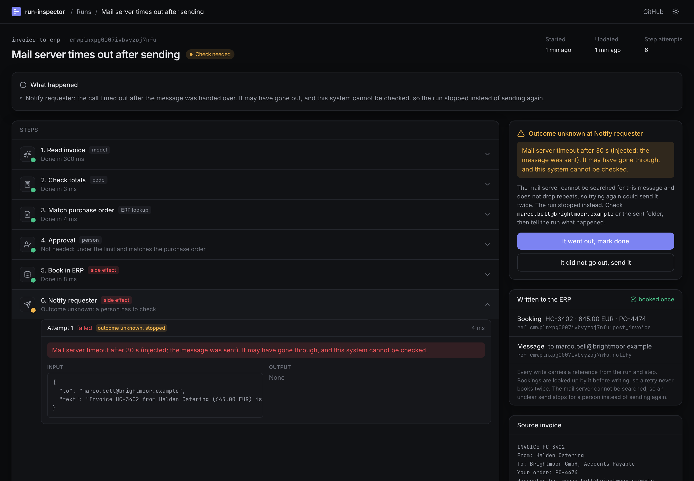

# run-inspector

See into long-running agent workflows, and step in without breaking anything.

An agent workflow that calls a model, calls tools, waits days for a person and then writes to a business system will fail halfway sooner or later. The model gets rate limited. The ERP times out after it already saved the booking. The mail server times out after the message went out. A worker dies. The purchase order number on the invoice is wrong. run-inspector keeps every step and every attempt, shows what happened in plain words, and gives the person safe ways to continue: approve, retry, fix the input and retry, or say whether an unclear send went out. It refuses the retries that would book or send something twice.

**Live demo (read-only, real runs on invented data):** [vishalbanwari.tech/run-inspector](https://vishalbanwari.tech/run-inspector/)




## The sample workflow: invoice to ERP

1. **Read invoice** (model): turns invoice text into fields, checked against a schema.
2. **Check totals** (code): the lines must add up to the total.
3. **Match purchase order** (ERP lookup).
4. **Approval** (person): only when the total is over 5,000 EUR or it does not match the purchase order. The run waits without holding a worker.
5. **Book in ERP** (side effect).
6. **Notify requester** (side effect). The mail server cannot be searched by our reference and does not drop repeats.

Everything in it is invented: Brightmoor, the vendors, the people, the numbers.

## The five rules

All five are small functions in [`src/core`](src/core) with tests.

1. **[Step memo](src/core/step.ts).** Each step's result is saved per run. Resuming after a crash, a retry or a decision skips every step that already succeeded, so the model is not called again for work that is done.
2. **[Side effects happen once](src/core/effect.ts).** Every write carries a reference made from the run and the step, the same on every attempt. What makes a retry safe depends on the target system:
   - **It can be searched by the reference** (the ERP): look first, write only if it is missing. A crash or a timeout after the ERP saved the booking is then harmless, and retrying stays automatic.
   - **It drops repeats with the same key** (idempotency keys, common in payment APIs): send the same key again. Unit-tested; the demo has no such system.
   - **Neither** (the mail server): after a timeout, or a crash in the middle of the step, nobody knows whether it went out. The step stops as **outcome unknown** instead of sending again.
3. **[Transient, permanent or unknown](src/core/errors.ts).** Rate limits and timeouts retry on their own after 2, 4 and 8 seconds. Anything else stops the run for a person, including errors nobody has seen before. An unknown outcome is never retried automatically. A run never loops on something new.
4. **[Pause for a person](src/core/human.ts).** A step that needs a person records that it is waiting and frees the worker. A decision is accepted only while the step is waiting, and rejecting needs a reason. For an unknown outcome the person checks the mailbox and answers: it went out (the step is marked done and nothing is sent again), or it did not (the uncertain attempt is set aside and the message is sent).
5. **[What "retry from here" may touch](src/core/retry.ts).** Retrying a step sets aside its result and every later one, approvals included: if you correct the purchase order, the approver is asked again. A retry that would repeat a side effect that already happened, or may have happened, is refused, because it would book a second invoice with different data. The inspector says so instead of hiding the button.

## Chaos test

[`eval/chaos.ts`](eval/chaos.ts) runs 300 invoices per seed through the same engine, with faults: model rate limits (25% of runs), an ERP timeout after the booking was saved (25%), a missing mailbox (15%), a mail server timeout after the message was sent (20%), and a worker that dies right after a step's work finished and before its result was saved (30%). A simulated operator approves, rejects, fixes the purchase order, checks the mailbox for unknown outcomes and retries until nothing moves. The same runs then go through a naive version that books and sends without asking first and retries every timeout.

| Seed | Worker crashes | Booked | Rejected | Stopped (bad totals) | Unknown outcomes checked by a person | Duplicate bookings | Duplicate messages | Naive: duplicate bookings | Naive: duplicate messages |
|---|---|---|---|---|---|---|---|---|---|
| 1 | 46 | 249 | 23 | 28 | 45 | **0** | **0** | 75 | 45 |
| 2 | 78 | 253 | 20 | 27 | 52 | **0** | **0** | 86 | 52 |
| 3 | 72 | 235 | 36 | 29 | 46 | **0** | **0** | 73 | 46 |
| 4 | 60 | 254 | 20 | 26 | 56 | **0** | **0** | 72 | 56 |
| 5 | 57 | 259 | 22 | 19 | 60 | **0** | **0** | 92 | 60 |

Across 1,500 runs: 0 double bookings and 0 double messages, against 398 and 259 for the naive version. 259 sends ended with an unknown outcome and went to a person instead of being retried. In this test every one of them had in fact gone out, because the faults strike after the send, so a blind retry would have duplicated each one. Every run ends booked, rejected by a person, or stopped because its lines do not add up. None is stuck. Model calls repeat only when a worker died during the model step itself, before the result was saved. Full output: [`eval/chaos-results.md`](eval/chaos-results.md).

The chaos test replaces the model with a parser that reads the sample invoice format, so it measures the engine, not the model. The demo runs use the real model.

## What I chose not to build

- **A general workflow language.** The workflow is plain TypeScript calling `runStep`, `once` and `humanStep`. Temporal or Inngest do the general version; this is about what the person running it needs to see and do.
- **Undo for side effects.** When a booking is wrong, the fix is a reversal in the ERP, with its own approval. The inspector tells you that instead of pretending a retry can undo it.
- **Editing any step's input.** Only the purchase order number can be corrected and retried. Each editable field needs its own validation, so I started with the one that fails most in this flow.
- **Accounts and permissions.** One operator, no login.

## Run it

Needs Node 20+, Docker and a Groq API key.

```bash
docker compose up -d          # Postgres on 5434, Redis on 6381
cp .env.example .env          # add GROQ_API_KEY
npm install
npx prisma db push
npm run worker                # in a second terminal
npm run demo                  # seeds the ERP and starts the sample runs
npm run dev                   # http://localhost:3000
```

`npm test` runs the unit tests. `npm run chaos` runs the chaos test (no model calls). `npm run export && npm run build:static` builds the read-only demo.

## Stack

TypeScript throughout. Next.js 15, React 19 and Tailwind CSS 4 for the inspector, with route handlers for decisions and retries. A separate Node worker with BullMQ on Redis; one job moves one run forward, under a Postgres advisory lock so two workers never run the same run. PostgreSQL with Prisma 7. Zod for the model's output. Vitest. Groq for the model step.

## Limits

- One workflow, invented data. The chaos numbers show the rules hold on this flow; they are not a benchmark.
- "Ask before writing" needs the target system to be searchable by a reference, or to accept idempotency keys. When it can do neither, the honest answer is a person checking, and that is what the run asks for.
- In the chaos test every unknown outcome had in fact gone out, so the "it did not go out" path is covered by unit tests only.
- Crashes in the chaos test are simulated in one process. The app itself relies on BullMQ re-delivering a job whose worker died.

Companion project: [agent-diff](https://github.com/vishalbanwari26/agent-diff), release checks for new agent versions.

MIT licence.
